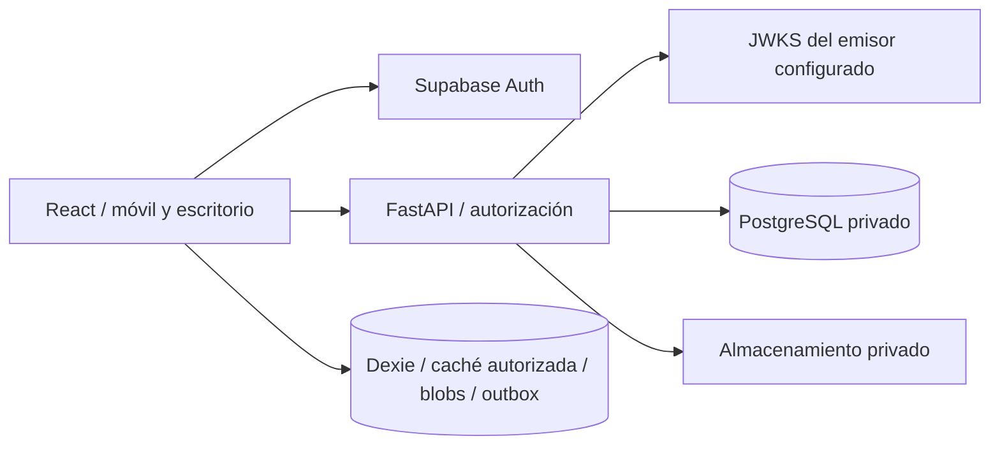

# 04 · Arquitectura y decisiones

## Estructura propuesta y materializada

```text
frontend/
  src/app/                    rutas, layout y proveedores
  src/components/             componentes visuales compartidos
  src/features/               auth, home, customers, orders, sync, settings
  src/lib/                    configuración pública y cliente API
  src/styles.css              tokens y estilos responsive
  e2e/                        recorridos con Playwright
backend/
  app/api/                    rutas HTTP y dependencias de autorización
  app/auth/                   contrato de identidad y adaptador Supabase
  app/core/                   configuración
  app/persistence/            SQLAlchemy, sesión y modelos iniciales
  migrations/                 revisiones Alembic explícitas
  tests/                      límites de seguridad, API y esquema
docs/                         requisitos, diseño y estado de validación
compose.yaml                  PostgreSQL, migración, API y web
```

El incremento actual usa `app/modules/schemas.py`, `operations.py` y `private_files.py`, con rutas `api/business.py` y `api/files.py`. `domain.ts` conserva zanahoria; `potato-domain.ts` y `app/domain/potato.py` interpretan el mismo `potato-rules.json` con aritmética racional exacta. El formulario comparte cliente, fecha, descripción, archivos y persistencia. [Reporte vigente](17_potato_orders.md).



## Decisiones registradas

- ADR-001: monolito modular, API REST versionada y una base PostgreSQL. Reduce complejidad operativa y permite transacciones de negocio.
- ADR-002: Supabase solo provee identidad. `IdentityProvider` separa el proveedor de membresías y permisos internos. No se utiliza `user_metadata` para autorizar.
- ADR-003: UUID, organización, timestamps UTC y versión desde la primera migración. Referencias compuestas evitan enlazar un pedido con un cliente de otra organización.
- ADR-004: SQLAlchemy síncrono con psycopg y endpoints síncronos en el pool de FastAPI. No combinar llamadas bloqueantes de base con rutas async.
- ADR-005: React Router, TanStack Query, React Hook Form y Zod. Caché de consultas en memoria, limpia al salir/cambiar de sesión. Caché Dexie separada por organización/usuario/rol y accesible solo durante autorización verificada vigente. `networkMode: always` deja que el adaptador decida entre API, caché autorizada o espacio local, sin pausar escrituras locales al perder red.
- ADR-006: vista previa disponible exclusivamente con `DEV` y `VITE_ENABLE_PREVIEW=true`. No hay usuario ficticio, token de desarrollo ni bypass en la API. El build de producción no habilita esa ruta.
- ADR-007: tokens Supabase y autorización verificada solo en memoria. Permiso offline hasta exp del token verificado, sin extensión adicional; reapertura en frío requiere login con red.
- ADR-008: Service Worker únicamente de producción para shell público, sin API ni tokens. Dexie conserva caché autorizada, capturas y blobs por identidad/organización; no limpia outbox en actualización/logout. Borradores sin intento son editables; intentos inciertos mantienen cuerpo/UUID. Reintento online en primer plano y comparación explícita de conflictos.
- ADR-009: migraciones como tarea separada antes de arrancar API. No ejecutar `create_all()` al arrancar ni migraciones simultáneas en workers.
- ADR-010: dependencias web fijadas en `package-lock.json`; Python mediante restricciones exactas en `requirements.lock` y rangos compatibles del proyecto. Las dependencias condicionales se seleccionan con los marcadores de cada paquete. Actualizaciones requieren repetir pruebas.
- ADR-011: contrato de papa y política de archivos como JSON en `backend/app/domain`, incluidos en el paquete Python e importados por Vite. El build Docker web usa contexto raíz y copia esos JSON. No duplicar fórmulas ni constantes comerciales entre lenguajes. Vectores de prueba compartidos verifican paridad.
- ADR-012: pesos derivados se reconstruyen; persistir entradas tipadas y total autorizado. HALF_UP a ocho decimales solo en salidas, total como suma de importes de línea. Guardar todos los cambios y auditoría en la misma transacción.
- ADR-013: versión del cálculo en pesajes de papa; v1 histórico conserva importes al consultar, v2 descuenta merma más merma adicional en nuevas escrituras. La migración 0005 etiqueta el histórico; no se reescriben notas al abrirlas. Formato de miles en componente compartido de entradas; RHF/API mantienen cadenas canónicas sin agrupación y el cursor se conserva por posición de caracteres numéricos.

## Design system

Tokens en `styles.css`: bosque `#163d31`, salvia `#edf1e8`, marfil `#f7f8f3`, texto `#263d32`, separadores `#e4e8df`; radios de 8–18 px y sombras suaves. DM Sans para lectura y Manrope para títulos, servidas localmente mediante paquetes, sin peticiones a proveedores de fuentes. Serif del sistema como acento editorial.

Componentes compartidos: marca, botones/enlaces de acción, encabezado, badges, estados vacíos y avisos de etapa. Navegación inferior móvil de 5 destinos, controles de al menos 44 px, formularios sin zoom automático en iOS, foco visible, enlace de salto, etiquetas explícitas y respeto a `prefers-reduced-motion`.

Referencias técnicas oficiales consultadas: [Vite](https://vite.dev/guide/), [JWT de Supabase](https://supabase.com/docs/guides/auth/jwts), [FastAPI en contenedores](https://fastapi.tiangolo.com/deployment/docker/).
